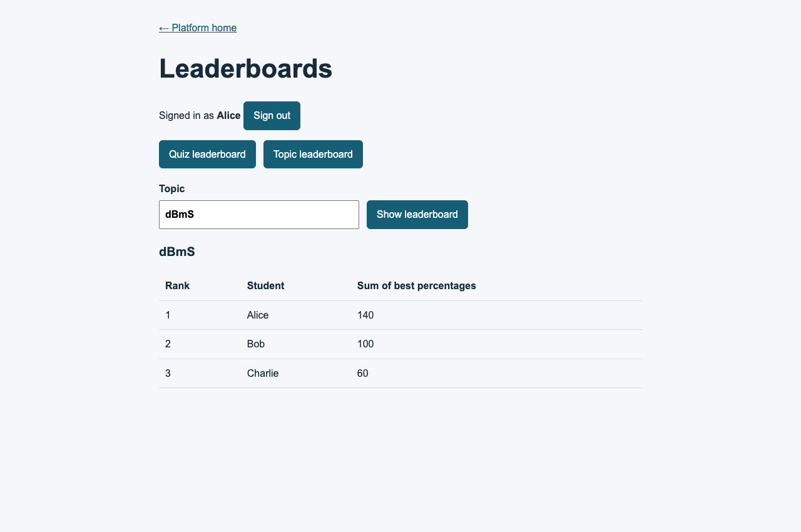

# TC-LB-09 browser acceptance

- Date: 30 October 2026
- Result: PASS
- Browser: Google Chrome 156.0.8078.76
- Environment: real React/Vite client, Express authentication and leaderboard routes, disposable MongoDB replica set
- Runner: `node scripts/ayush-leaderboard-browser.cjs`

Verified in one authenticated browser session:

1. Quiz leaderboard uses each student's highest score and competition ranks `1, 1, 3`.
2. Switching to the topic leaderboard does not reload the page.
3. A case-insensitive `dBmS` query aggregates best percentages across published quizzes as `140, 100, 60`.
4. No mock API or production identity is used; all data is disposable.

